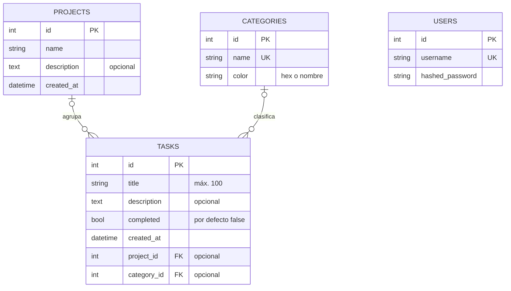

# Práctica 1.5 – Modelos SQLAlchemy y conexión a BD

## Objetivo

Guardar los datos de verdad en una base de datos SQLite (`taskflow.db`) usando SQLAlchemy, en lugar de en listas en memoria que se pierden al reiniciar.

## Archivos nuevos o modificados

```
app/
├── main.py              # + lifespan: crea las tablas al arrancar
├── core/
│   ├── config.py        # + DATABASE_URL, SQL_ECHO, DB_TIMEOUT
│   ├── database.py      # NUEVO: engine, SessionLocal, Base, get_db()
│   ├── deps.py          # NUEVO: DbSession y get_current_user (dependencia anidada)
│   └── security.py      # NUEVO: hash de contraseñas
├── models/
│   ├── __init__.py
│   └── models.py        # NUEVO: User, Project, Category, Task (según el doc. del proyecto)
├── schemas/user.py      # NUEVO: UserCreate, UserRead
└── routers/
    ├── users.py         # NUEVO: POST /users, GET /users/me
    ├── projects.py      # ahora usa la BD (+ GET /projects/{id})
    └── tasks.py         # ahora usa la BD (+ filtros ?project_id= y ?completed=)
requirements.txt         # + SQLAlchemy==2.1.6
```

`database.py` está en `core/` y `models.py` en `models/`, siguiendo la arquitectura de la práctica 1.3. El enunciado deja colocarlos así.

## 1. ¿Qué es un ORM?

Un ORM (*Object-Relational Mapping*) traduce entre **tablas** de la base de datos y **clases** de Python. Cada fila es un objeto y cada columna, un atributo. En lugar de escribir SQL a mano, se trabaja con objetos:

```python
# Con ORM (SQLAlchemy)
task = Task(title="Hacer la 1.5", project_id=1)
db.add(task)
db.commit()

# Equivalente en SQL directo
# INSERT INTO tasks (title, project_id, completed) VALUES ('Hacer la 1.5', 1, 0);
```

### ORM frente a SQL directo

| | ORM (SQLAlchemy) | SQL directo |
|---|---|---|
| Código | Python, con autocompletado y tipos | Cadenas de texto con SQL |
| Seguridad | Parámetros escapados automáticamente (sin inyección SQL) | Hay que usar parámetros con cuidado |
| Cambiar de BD | Se cambia `DATABASE_URL` (SQLite → PostgreSQL) | Hay que adaptar el SQL de cada motor |
| Relaciones | `project.tasks`, `task.project` | `JOIN` a mano |
| Rendimiento | Algo de sobrecarga; puede generar consultas de más si no se tiene cuidado | Control total de la consulta |
| Consultas complejas | Pueden quedar enrevesadas | Más claras |

**Cuándo uso cada uno:** el ORM para el CRUD normal de la API, que es el 90 % del trabajo. SQL directo (con `text()` de SQLAlchemy) para informes, estadísticas o consultas muy complejas o críticas en rendimiento, donde conviene controlar exactamente el SQL.

## 2. `core/database.py`

### Engine

```python
engine = create_engine(
    DATABASE_URL,                     # sqlite:///./taskflow.db por defecto
    connect_args={"check_same_thread": False, "timeout": DB_TIMEOUT},  # solo SQLite
    echo=SQL_ECHO,
    pool_pre_ping=True,
)
```

- **`DATABASE_URL` configurable por entorno:** en desarrollo es SQLite y en otro entorno se cambia la variable sin tocar el código (`set DATABASE_URL=postgresql+psycopg://...`).
- **`check_same_thread=False`:** FastAPI atiende las peticiones en varios hilos, y SQLite por defecto solo permite usar una conexión en el hilo que la creó. Es seguro porque cada petición tiene su propia sesión.
- **`timeout`:** si otra escritura tiene la BD bloqueada, espera hasta 30 s en vez de fallar al momento con `database is locked`.
- **`pool_pre_ping=True`:** antes de reutilizar una conexión, comprueba que sigue viva. Evita errores cuando el servidor de BD ha cerrado conexiones inactivas.
- **`echo`:** con `set SQL_ECHO=1` se ve en la consola todo el SQL que genera SQLAlchemy. Viene muy bien para aprender.
- **Claves foráneas en SQLite:** SQLite no las comprueba salvo que se active `PRAGMA foreign_keys=ON` en cada conexión, y eso es lo que hace el `event.listens_for(engine, "connect")`.

### Pooling

Abrir una conexión con la BD es lento. El engine mantiene un **pool** de conexiones abiertas y se las presta a cada sesión; cuando la sesión se cierra, la conexión vuelve al pool en vez de cerrarse. Con SQLite en archivo, SQLAlchemy usa `QueuePool` por defecto. Con PostgreSQL se ajustaría con `pool_size`, `max_overflow` y `pool_timeout`.

### SessionLocal

```python
SessionLocal = sessionmaker(bind=engine, autoflush=False, expire_on_commit=False)
```

- **`expire_on_commit=False`:** después del `commit()` los objetos mantienen sus valores en memoria. Con el valor por defecto (`True`), al devolver el objeto en la respuesta SQLAlchemy haría otra consulta para recargarlo, o fallaría si la sesión ya estuviera cerrada.
- **`autoflush=False`:** los cambios solo se envían a la BD cuando nosotros lo decidimos (`commit`), lo que lo hace más predecible.

### `get_db()`: una sesión por petición

```python
def get_db():
    db = SessionLocal()
    try:
        yield db
    except Exception:
        db.rollback()
        raise
    finally:
        db.close()
```

Con `yield`, FastAPI abre la sesión al empezar la petición, se la pasa al endpoint y, al terminar, ejecuta el `finally`. La sesión **se cierra siempre**, aunque haya un error. Si hay una excepción, además se hace `rollback` para no dejar cambios a medias.

## 3. Modelos (`models/models.py`)

Son cuatro modelos declarativos (heredan de `Base`): `User`, `Project`, `Category` y `Task`. Siguen el **modelo de dominio del documento "Qué vamos a construir"** (apartado 6).

**Variante simple (apartado 6.3):** todos los usuarios autenticados comparten el mismo espacio de proyectos y tareas, así que **no hay `owner_id`** y `User` no se relaciona con `Project` ni con `Task`. Es la variante que recomienda el documento para el proyecto base.

### Diagrama del esquema



Diferencias con el documento, y por qué:
- `Project.created_at`: no aparece en el modelo de dominio, pero `ProjectRead` lo incluye desde la práctica 1.2, así que lo guardo en la BD.
- `Category.name` es único, para no tener dos categorías que se llamen igual.

### Relaciones y `back_populates`

| Relación | Lado "uno" | Lado "muchos" | Al borrar el "uno"… |
|---|---|---|---|
| Project – Task | `project.tasks` | `task.project` | **se borran sus tareas** (`cascade="all, delete"` + `ondelete="CASCADE"`) |
| Category – Task | `category.tasks` | `task.category` | las tareas se quedan sin categoría (`ondelete="SET NULL"`) |

- **`back_populates`** conecta los dos lados de una relación. Si hago `task.project = p`, automáticamente `p.tasks` incluye esa tarea, y al revés.
- **Decisión RF-12:** al eliminar un proyecto **se eliminan sus tareas** en cascada. Lo decido así porque las tareas de un proyecto forman parte de él y dejarlas sueltas acumularía tareas sin contexto. Se aplica en los dos niveles: en el ORM (`cascade`) y en la BD (`ondelete="CASCADE"`), para que sea consistente se borre como se borre. Las tareas que no tienen proyecto no se ven afectadas.
- **Categorías:** en cambio, borrar una categoría **no** borra tareas. Solo les quita la categoría, porque es una simple etiqueta.
- **`Task.project_id`** es la FK a `Project` (criterio de aceptación). Es opcional, como dice el documento. Si se indica un proyecto o una categoría que no existen, la API devuelve 404.
- **`User.hashed_password`:** la contraseña nunca se guarda en texto plano (RNF-01). Por ahora uso PBKDF2 de la librería estándar (`core/security.py`). En la práctica de autenticación se cambiará por bcrypt.

## 4. Integración con FastAPI

Todos los endpoints que tocan la BD reciben la sesión con `Depends(get_db)`, usando un alias para no repetirlo:

```python
DbSession = Annotated[Session, Depends(get_db)]

@router.post("")
def create_task(data: TaskCreate, db: DbSession):
    ...
```

### Dependencia anidada: `get_current_user` → `get_db`

```python
def get_current_user(db: DbSession, x_user_id: int | None = Header(None)) -> User:
    ...
```

`get_current_user` necesita a su vez la sesión de la BD para buscar al usuario. FastAPI resuelve la cadena él solo: primero `get_db`, luego `get_current_user`, y por último el endpoint. Si un endpoint pide las dos, **comparten la misma sesión** dentro de la petición.

Por ahora identifica al usuario con la cabecera `X-User-ID`, y se usa en `GET /api/v1/users/me`. Cuando haya login, solo cambiará el interior de `get_current_user` (leerá un token); los endpoints que la usan no tendrán que cambiar.

## 5. Endpoints

| Método | Ruta | Qué hace |
|---|---|---|
| POST | `/api/v1/users` | Registra un usuario con username y contraseña (409 si el username ya existe) |
| GET | `/api/v1/users/me` | Usuario de la cabecera `X-User-ID` (401 si falta o no existe) |
| GET | `/api/v1/projects` | Lista los proyectos |
| GET | `/api/v1/projects/{id}` | Un proyecto (404 si no existe) |
| POST | `/api/v1/projects` | Crea un proyecto |
| GET | `/api/v1/tasks?project_id=&completed=` | Lista las tareas, con filtros opcionales por proyecto y estado |
| POST | `/api/v1/tasks` | Crea una tarea; proyecto y categoría opcionales (404 si no existen) |

## 6. Prueba

1. Arranco el servidor: se crea `taskflow.db` en la carpeta del proyecto.
2. `POST /api/v1/projects` con `{"name": "TaskFlow"}` → 201, `id: 1`.
3. `POST /api/v1/tasks` con `{"title": "Hacer la 1.5", "project_id": 1}` → 201.
4. `POST /api/v1/tasks` con `"project_id": 99` → 404 `Proyecto no encontrado`.
5. `POST /api/v1/tasks` con solo `{"title": "Sin proyecto"}` → 201: el proyecto es opcional.
6. Reinicio uvicorn y `GET /api/v1/tasks`: **la tarea sigue ahí**, porque ahora está guardada en la BD.

`taskflow.db` está en `.gitignore`: la base de datos no se sube al repositorio, porque cada uno genera la suya al arrancar.

## Arrancar

```bat
.\.venv\Scripts\activate.bat
pip install -r requirements.txt
uvicorn app.main:app --reload
```
